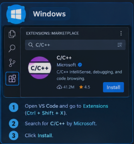
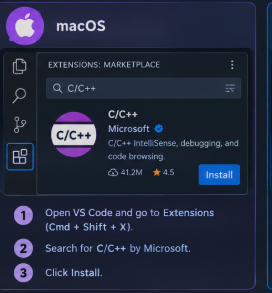
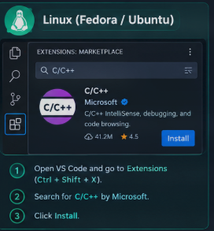

#                                                                                             Setup & Introduction
---

## What is **C++**?

C++ is a low level, general purpose, high performance compiler based language.

---

## Why **C++** is used?

**C++** is used to build high performance software, game engines, operating system, embedded systems and other applications where control over computer resources is required.

---

## C++ Pro's and Con's.

| Pro's            | Con's                      |
| ---------------- | -------------------------- |
| High Performance | Cryptic and complex syntax |
| Memory Control   | Memory Management risk     |
| Versatility      | Longer development time    |

---

## Installing C++:-  (VS Code)


### Windows:-

- Install a C++ compiler: Follow Microsoft's [MinGW-w64 setup guide](https://code.visualstudio.com/docs/cpp/config-mingw?utm_source=chatgpt.com) to install GCC through MSYS2, or install Microsoft's [C++ Build Tools](https://visualstudio.microsoft.com/visual-cpp-build-tools/?utm_source=chatgpt.com).
    
- Install VS Code: Download it from the [official VS Code website](https://code.visualstudio.com/?utm_source=chatgpt.com).
    
- Install the C/C++ extension: Open VS Code, press `Ctrl + Shift + X`, search for C/C++ by Microsoft, and install it.
    
- Run C++: Create `main.cpp`, select your installed compiler, and compile and run your program using the terminal or VS Code's build and debug controls.



### MacOS:-

- Install a C++ compiler: Install Apple's command-line developer tools by opening Terminal and running:
      ```
    ```
    xcode-select --install
    ```
    
    
- Install VS Code: Download it from the [official VS Code website](https://code.visualstudio.com/?utm_source=chatgpt.com).
    
- Install the C/C++ extension: Open VS Code, press `Cmd + Shift + X`, search for C/C++ by Microsoft, and install it.
    
- Run C++: Create a file named `main.cpp`. Compile and run it using the terminal with the Clang compiler.




### LInux(Fedora/Ubuntu):- 

1. Install a C++ compiler:
    
    - Fedora: Open the terminal and run `sudo dnf install gcc-c++ gdb`
        
    - Ubuntu: Run `sudo apt update && sudo apt install build-essential gdb`
        
    
2. Install VS Code: Download it from the [official VS Code website](https://code.visualstudio.com/?utm_source=chatgpt.com).
    
3. Install the C/C++ extension: Open VS Code, press `Ctrl + Shift + X`, search for C/C++ by Microsoft, and install it.
    
4. Write and run C++: Create a file named `main.cpp`, write your code, and compile it using the terminal.


